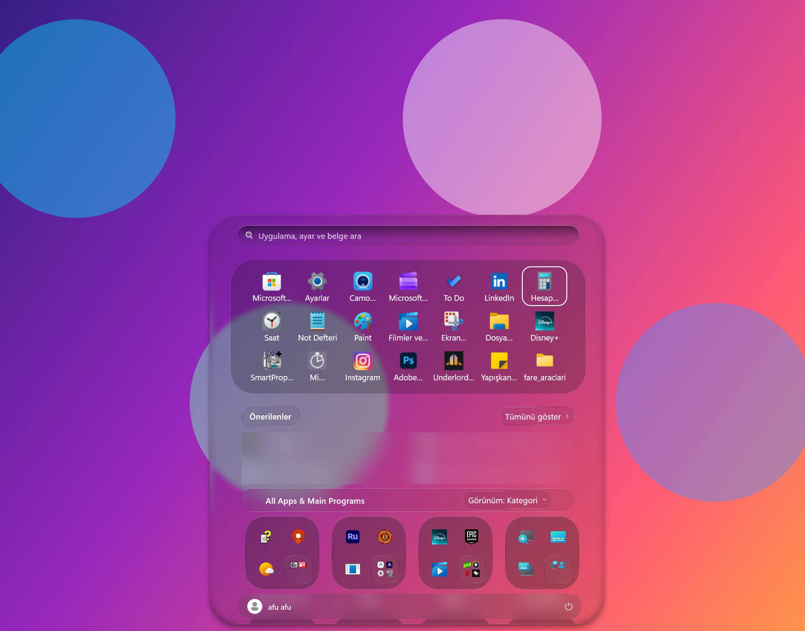
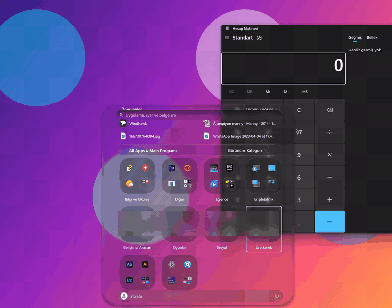
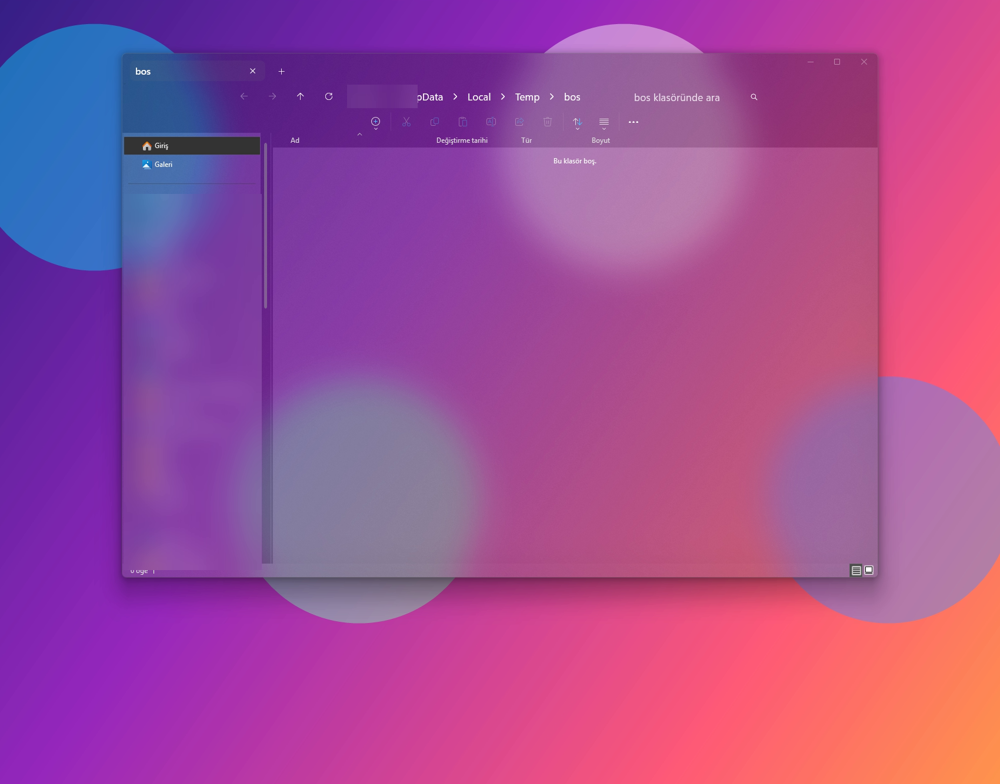

# Windhawk Liquid Glass

A translucent "liquid glass" look for **Windows 11** — taskbar, Start menu and File Explorer —
built with three [Windhawk](https://windhawk.net) mods and a few saved settings.
No theme patcher, no system file changes: Windhawk injects the mods at runtime and you can undo everything in one click.



<p align="center"></p>

## What you get

| Where | Mod | Theme |
|---|---|---|
| Taskbar | [Windows 11 Taskbar Styler](https://windhawk.net/mods/windows-11-taskbar-styler) | `WindowGlass` |
| Start menu | [Windows 11 Start Menu Styler](https://windhawk.net/mods/windows-11-start-menu-styler) | `LiquidGlass2` (new layout forced) |
| File Explorer | [Windows 11 File Explorer Styler](https://windhawk.net/mods/windows-11-file-explorer-styler) | `WindowGlass` + acrylic blur |




The glass is real transparency: whatever is behind the window (wallpaper, other windows) shows through, blurred.
A colourful wallpaper makes it look much better than a black one.

## Install (about 5 minutes)

1. Install [Windhawk](https://windhawk.net) (free, open source).
2. In Windhawk open **Explore** and install these three mods:
   - `Windows 11 Taskbar Styler`
   - `Windows 11 Start Menu Styler`
   - `Windows 11 File Explorer Styler`
3. Download this repo, open **PowerShell as Administrator** in its folder and run:
   ```powershell
   Set-ExecutionPolicy -Scope Process Bypass
   .\scripts\apply-settings.ps1
   ```
   It writes the saved theme settings into Windhawk and restarts Explorer.
4. Optional check:
   ```powershell
   .\scripts\check.ps1
   ```
   You should see a `*-styler` module listed for both `explorer` and `StartMenuExperienceHost`.

Prefer to do it by hand? Open each mod in Windhawk → **Settings** and copy the values from [`settings/`](settings).

## Starts with Windows

Windhawk installs a service (`Auto` start). Mods are injected the moment Explorer and the Start menu process launch,
so the glass is there from the first login screen of your desktop. Nothing else to configure.

## Troubleshooting

- **Mods are installed but nothing changes after a Windhawk reinstall/update.** The mod list lives in the registry
  (`HKLM\SOFTWARE\Windhawk\Engine\Mods`). If it is empty, reinstall the mods from **Explore**, then run `apply-settings.ps1` again.
- **Start menu looks plain.** Make sure the mod's *Process inclusion list* contains `StartMenuExperienceHost.exe`, then restart Explorer.
- **Want it gone.** Disable the three mods in Windhawk. Nothing else was changed on your system.

## Credits

All the heavy lifting is done by the Windhawk mods by [m417z](https://github.com/m417z) and contributors.
This repo only shares a tested combination of settings plus a helper script.
